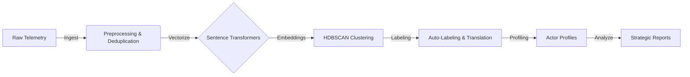

# Automated Information Environment Assessment (IEA) Pipeline


## Overview

This repository engineers an end-to-end **OSINT intelligence pipeline** designed to monitor, cluster, and analyze adversarial narratives in high-volume telemetry environments (specifically **Telegram**).

Unlike traditional keyword-based monitoring, this system utilizes **unsupervised machine learning (HDBSCAN)** and **semantic vectorization (BERT)** to identify emerging disinformation campaigns, measure narrative dominance, and detect coordinated inauthentic behavior without prior manual labeling.

**Core Mission:** Move from raw data to actionable intelligence—identifying *who* is saying *what*, *when*, and with *how much coordination*.

---

## Key Intelligence Findings (Jan 2026 Run)

Based on the automated analysis of **42,244 messages** from the Ukraine-Russia and Israel-Palestine theaters:

### 1. High "Noise" Ratio as an Indicator of Authenticity
The pipeline filtered out **81.7%** of messages as "noise" (organic/unique content). 
* **Official Channels** (MoD, Ministries) showed high clustering (>30%), indicating rigid, templated communication protocols.
* **Influencers** (e.g., Podolyak, Soloviev) exhibited **95% unique content**, validating that they operate as independent opinion shapers rather than automated amplifiers.

### 2. The "Silo" Effect (Zero Mirroring)
Mirror Analysis detected **0.00** semantic overlap between Russian and Ukrainian official channels.
* **Assessment:** Adversaries are not engaging in dialogue or counter-narrative debates. They are broadcasting parallel, disconnected realities to isolated audiences.

### 3. Temporal Anomalies (Early Warning)
Using Z-Score statistical analysis, the system detected coordinated amplification events:
* **Critical Spike (Oct 13):** Simultaneous surge in *Casualty Reporting* by both IL and PS actors (Z-Score **5.62**), indicating a reactive information operation triggered by a major kinetic event.
* **Defensive Spike (Oct 14):** 5x volume increase in *Air Raid Alerts* by Israeli channels, correlating with saturation attacks.

> **Deep Dive:** [Read the full ANALYSIS_REPORT.md](./ANALYSIS_REPORT.md) for detailed charts and actor profiles.

---

## System Architecture

The pipeline follows a modular **ETL (Extract, Transform, Load)** architecture, optimized for reproducibility and auditability. The system decouples data ingestion from analysis, allowing rapid iteration on AI models without re-scraping historical data.



## Technical Pipeline Stages

The system is composed of **7 distinct stages**, executed sequentially:

### 1. Ingestion (`00_gather_data.py`)

* **Source**: Asynchronous Telethon Scraper
* **Target**: 20+ high-volume Telegram channels (Official, Media, Influencers)
* **Capabilities**:

  * Rate-limit handling
  * Media exclusion
  * Metadata extraction

### 2. Data Health Check (`10_quick_audit.py`)

* **Goal**: Early validation
* Checks raw CSV integrity, volume per channel, and date ranges before expensive processing

### 3. Preprocessing (`20_preprocess_v1.py`)

* **Deduplication**: SHA1 hashing of normalized text to strictly remove copy-paste spam
* **Cleaning**: Regex-based artifact removal (URLs, usernames)
* **Language Detection**: `langdetect` filtering for relevant operational languages

### 4. Vectorization (`30_build_embeddings.py`)

* **Model**: `sentence-transformers/paraphrase-multilingual-MiniLM-L12-v2`
* **Output**: 384-dimensional dense vectors
* **Advantage**: Cross-lingual semantic comparison (e.g. Russian vs English narratives)

### 5. Clustering (`40_cluster_narratives.py`)

* **Algorithm**: HDBSCAN (Hierarchical Density-Based Spatial Clustering)
* **Config**: `min_cluster_size=10`
* **Goal**: Group semantically similar messages and reject organic noise

### 6. Auto-Labeling (`51_label_top_clusters.py`)

* **Method**: TF-IDF keyword extraction per cluster
* **Translation**: Google Translate API for automatic English intelligence summaries

### 7. Strategic Analysis (`53_narrative_analysis.py`)

* **Dominance Score**: Measures narrative ownership using asymmetry metrics
* **Spike Detection**: Z-score anomaly detection for unusual narrative volume

## Target Telemetry Sources (`config/channels.yaml`)

The system monitors **12 high-volume channels** across two active conflict theaters, categorized by actor type to analyze narrative propagation flow.

| Theater | Actor          | Type       | Channel                   | Role                           |
| ------- | -------------- | ---------- | ------------------------- | ------------------------------ |
| UA–RU   | 🇺🇦 Ukraine   | Official   | `@ministry_of_defense_ua` | Formal communiqués             |
| UA–RU   | 🇺🇦 Ukraine   | Influencer | `@M_Podolyak`             | Political commentary (organic) |
| UA–RU   | 🇷🇺 Russia    | Official   | `@mod_russia`             | Daily briefings                |
| UA–RU   | 🇷🇺 Russia    | Influencer | `@SolovievLive`           | Propaganda amplification       |
| IL–PS   | 🇮🇱 Israel    | Official   | `@idfofficial`            | Operational alerts             |
| IL–PS   | 🇮🇱 Israel    | Influencer | `@hnaftali`               | Hybrid rapid alerts            |
| IL–PS   | 🇵🇸 Palestine | Official   | `@MOHMediaGaza`           | Casualty statistics            |
| IL–PS   | 🇵🇸 Palestine | Media      | `@AJArabicNews`           | Regional narrative framing     |

> **Note**: The full list is configured in `config/channels.yaml`. The scraper is designed to handle rate-limits for these high-traffic sources.

---

## Installation & Usage

### Resource Warning

* **System Requirements**:

  * Memory-intensive ML models (BERT-based)
* **Docker Image Size**:

  * ~5GB compressed
  * ~15–20GB uncompressed on disk
* **RAM**:

  * Minimum 8GB
  * 16GB recommended for HDBSCAN on datasets larger than 50k rows

### Prerequisites (Credentials)

To run the scraper, obtain Telegram API credentials:

1. Go to `https://my.telegram.org`
2. Create a new application
3. Copy your `api_id` and `api_hash`

### Option A: Docker (Recommended)

```bash
# 1. Clone the repository
git clone https://github.com/UrsaruBoss/narrative-war-iea.git
cd narrative-war-iea

# 2. Configure credentials
echo "TG_API_ID=your_api_id_here" > .env
echo "TG_API_HASH=your_api_hash_here" >> .env

# 3. Build and run (ensure 20GB+ disk space)
docker-compose up --build
```

### Option B: Local Python

```bash
pip install -r requirements.txt

# 1. Setup .env with TG_API_ID and TG_API_HASH manually

# 2. Run the Full Intelligence Cycle
python scripts/00_gather_data.py --days 30
python scripts/10_quick_audit.py
python scripts/20_preprocess_v1.py
python scripts/30_build_embeddings.py
python scripts/40_cluster_narratives.py --min_cluster_size 10

# 3. Generate Reports
python scripts/50_analyze_clusters.py
python scripts/51_label_top_clusters.py --translate --autolabel
python scripts/52_actor_narrative_profile.py
python scripts/53_narrative_analysis.py
python scripts/90_summary.py
```

---

## Project Structure

```plaintext
├── config/
│   └── channels.yaml            # Target definitions (actors, sides, conflicts)
├── data/
│   ├── raw/                     # Raw Telegram telemetry (CSV)
│   └── features/                # Embeddings (.npy) and clustering output
├── reports/
│   └── <run_name>/              # Generated intelligence products
│       ├── actor_narrative_profile.csv
│       ├── analysis/            # Spikes, timelines, asymmetry metrics
│       ├── cluster_label_draft.csv
│       └── summary.md
├── scripts/
│   ├── 00_gather_data.py        # Ingestion & scraper logic
│   ├── 10_quick_audit.py        # Data integrity & volume checks
│   ├── 20_preprocess_v1.py      # Cleaning & deduplication
│   ├── 30_build_embeddings.py   # Semantic vectorization (BERT)
│   ├── 40_cluster_narratives.py # HDBSCAN clustering engine
│   ├── 50_analyze_clusters.py   # Cluster statistics
│   ├── 51_label_top_clusters.py # Auto-labeling & translation
│   ├── 52_actor_narrative_profile.py # Actor profiling & attribution
│   ├── 53_narrative_analysis.py # Strategic analysis (spikes/mirrors)
│   └── 90_summary.py            # Final report generation
├── .env.example                 # Template for credentials
├── Dockerfile
└── README.md
```

## Project Goals

* **Automated Watchdog**: Set-and-forget system that alerts analysts only on narrative anomalies
* **Language Agnosticism**: Unified vector space for Russian, Arabic, Hebrew, and English
* **Cross-Platform Ready**: Modular design allows swapping Telegram for X/Twitter or TikTok ingestion

## License & Disclaimer

This tool is for **educational and research purposes only**. Data collection is limited to public Telegram channels and intended strictly for open-source intelligence (OSINT) analysis.
